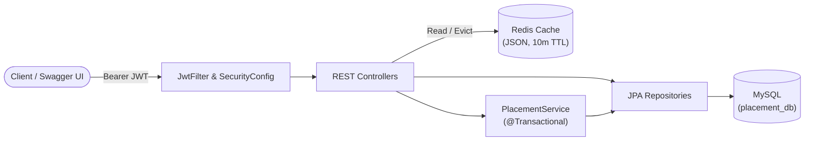
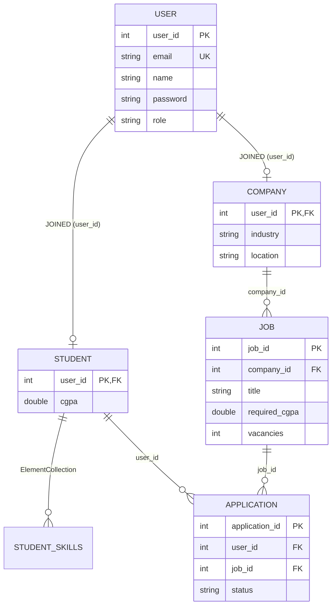

# College Placement Management System API

A RESTful backend built with **Java 21** and **Spring Boot 4.1** for managing campus placements, student profiles, job postings, and application workflows.

* **Live Swagger UI:** [https://placement-backend-production-8827.up.railway.app/swagger-ui/index.html](https://placement-backend-production-8827.up.railway.app/swagger-ui/index.html)
* *Note: Hosted on Railway (serverless sleep enabled). The first request after inactivity may take 15 to 30 seconds to wake the container.*

---

## Tech Stack

* **Core:** Java 21, Spring Boot 4.1.1, Maven
* **Security:** Spring Security, JWT (`jjwt` 0.11.5, HS256), BCrypt
* **Database & Cache:** MySQL 8.0 (Spring Data JPA / Hibernate), Redis (JSON cache, 10-min TTL)
* **Docs & Validation:** SpringDoc OpenAPI 3.1 (Swagger UI), Jakarta Bean Validation

---

## System Architecture



### Database Schema (Joined Inheritance)



### Key Highlights

* **Role & Ownership Security:** Stateless JWT authentication paired with principal email verification so students and companies can only modify their own resources.
* **Transactional Eligibility Checks:** Prevents duplicate applications (`unique(user_id, job_id)`), validates CGPA cutoffs, and atomically decrements job vacancies.
* **Smart Redis Caching:** Caches `GET /api/jobs` as JSON for 10 minutes and automatically evicts the cache when jobs, applications, or company profiles change.
* **Centralized Error Handling:** `@RestControllerAdvice` maps validation, security, and domain exceptions to clean HTTP `400`, `401`, `403`, `404`, and `409` JSON responses.

---

## API Endpoints

### Auth (`/api/auth`)
| Method | Endpoint | Access | Description |
| :--- | :--- | :--- | :--- |
| `POST` | `/api/auth/register` | Public | Register a `STUDENT` or `COMPANY` (returns `userId` and `role`) |
| `POST` | `/api/auth/login` | Public | Login and receive a JWT, `userId`, and `role` |

### Students (`/api/students`)
| Method | Endpoint | Access | Description |
| :--- | :--- | :--- | :--- |
| `GET` | `/api/students` | `COMPANY` | List all student profiles |
| `PUT` | `/api/students/{id}/profile` | `STUDENT` (Owner) | Update CGPA (`0.0` to `10.0`) and skills |
| `POST` | `/api/students/{studentId}/apply/{jobId}` | `STUDENT` (Owner) | Apply for a job (evicts `jobs` cache) |
| `GET` | `/api/students/{studentId}/applications` | `STUDENT` (Owner) | View submitted job applications |

### Companies (`/api/companies`)
| Method | Endpoint | Access | Description |
| :--- | :--- | :--- | :--- |
| `GET` | `/api/companies` | `STUDENT` | List all registered companies |
| `PUT` | `/api/companies/{id}/profile` | `COMPANY` (Owner) | Update industry and location (evicts `jobs` cache) |
| `DELETE` | `/api/companies/{id}` | `COMPANY` (Owner) | Delete company and cascade-delete its jobs and applications |

### Jobs (`/api/jobs`)
| Method | Endpoint | Access | Description |
| :--- | :--- | :--- | :--- |
| `GET` | `/api/jobs` | Authenticated | List all jobs (cached in Redis) |
| `POST` | `/api/jobs` | `COMPANY` (Owner) | Post a new job (evicts `jobs` cache) |
| `GET` | `/api/jobs/{jobId}/applications` | `COMPANY` (Owner) | View all applicants for a job |
| `PUT` | `/api/jobs/applications/{applicationId}/status` | `COMPANY` (Owner) | Update status (`APPLIED`, `REVIEWING`, `ACCEPTED`, `REJECTED`) |
| `DELETE` | `/api/jobs/{id}` | `COMPANY` (Owner) | Delete a job and its applications (evicts `jobs` cache) |

---

## Quick Test Payloads

**1. Register (`POST /api/auth/register`)**
```json
{
  "name": "Aarav Sharma",
  "email": "aarav@college.edu",
  "password": "securePassword123",
  "role": "STUDENT"
}
```

**2. Update Student Profile (`PUT /api/students/{id}/profile`)**
```json
{
  "cgpa": 8.6,
  "skills": ["Java", "Spring Boot", "MySQL", "Redis"]
}
```

**3. Update Company Profile (`PUT /api/companies/{id}/profile`)**
```json
{
  "industry": "Cloud Computing",
  "location": "Bengaluru"
}
```

**4. Post a Job (`POST /api/jobs`)**
```json
{
  "title": "Backend Software Engineer",
  "requiredCgpa": 7.5,
  "vacancies": 5,
  "companyId": 2
}
```

---

## Local Setup

### Prerequisites
* **JDK 21**
* **MySQL** running on port `3306` (`placement_db` is auto-created)
* **Redis** running on port `6379`

### Environment Variables
| Variable | Description | Default Fallback |
| :--- | :--- | :--- |
| `DB_URL` | MySQL JDBC URL | `jdbc:mysql://localhost:3306/placement_db?createDatabaseIfNotExist=true` |
| `DB_USER` | MySQL username | `root` |
| `DB_PASS` | MySQL password | `your_local_password` |
| `REDIS_HOST` | Redis host | `localhost` |
| `REDIS_PORT` | Redis port | `6379` |
| `JWT_SECRET` | 256-bit secret key (>= 32 chars) | `some-long-local-dev-secret-at-least-32-characters` |

### Run Locally

```powershell
git clone [https://github.com/vivekwaldia/placement-backend.git](https://github.com/vivekwaldia/placement-backend.git)
cd placement-backend

# Windows PowerShell
$env:DB_PASS="your_mysql_password"; $env:JWT_SECRET="your_256_bit_secret_key_at_least_32_chars"; .\mvnw spring-boot:run
```

Open `http://localhost:8080/swagger-ui/index.html` to test the endpoints.

---

## Contact

**Vivek** - [waldia.vivek@gmail.com](mailto:waldia.vivek@gmail.com)
